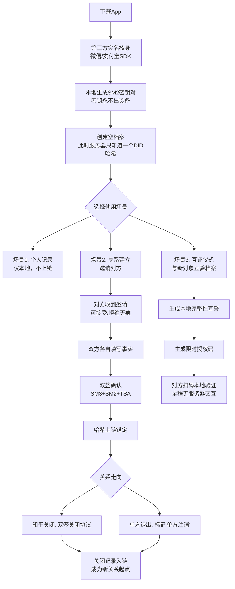

# 《信册 TrustBook》产品设计文档（PRD v1.0）
**文档状态**：概念定稿 → 待技术评审
**文档密级**：内部公开
**版本**：v1.0 | **日期**：2026-10-21
**产品代号**：信册（暂定）
---
## 一、产品简介
### 1.1 一句话定位
**信册是一个双边实名互签的"关系事实存证工具"——用户自持数据、平台零存储、密码学保证不可篡改。**
它不是婚恋平台，不是背景调查工具，不是信用评分系统。它做的事情只有一件：**让两个人在自愿、平等、互知的前提下，共同签署并锁定一段关系的事实记录，并在未来的某一天能向新对象证明"这份档案是真的、且我宣誓过它是完整的"。**
### 1.2 核心隐喻：公证处，不是评审团
| 维度 | 传统婚恋背调 | 信册 |
|---|---|---|
| 触发方 | 不信任的一方主动查 | 认真的一方主动出示 |
| 数据来源 | 平台爬取/他人爆料 | 当事人双方共同签字 |
| 价值立场 | 隐含"经历多=有问题" | 严格中立，不评判任何经历模式 |
| 数据归属 | 平台数据库 | 用户本地设备 |
| 平台角色 | 信息中介 | 存证公证人 |
使用者完全可以有自己的偏好——有人在意经历多少，有人在意关闭方式是否体面——这是用户的事。**系统只回答一个问题：这份档案是否经过双方确认、是否未被篡改、是否与宣誓一致。**
### 1.3 产品的原点洞察
> **"认真的关系双方会希望公开。"**
这句话决定了产品的使用场景不在关系之前（筛查），而在关系之中（承诺仪式）。确定关系时、见家长前、谈婚论嫁时，双方互验档案——这一刻本身就是产品要服务的对象。
---
## 二、产品价值
### 2.1 用户价值
| 用户群体 | 价值 |
|---|---|
| **认真进入新关系的人** | 拿到一份无法被对方事后抵赖的关系档案，大幅降低"信息不对等"带来的心理成本 |
| **重视自身清白的人** | 用"完整性宣誓 + 双签历史"证明自己一直选择诚实，这是语言无法替代的资产 |
| **关系中的双方** | "互证仪式"本身即是一次深度承诺，比口头承诺更郑重 |
| **经历分手的人** | 双签的"和平关闭"记录，是对双方的名誉保护——比单方面涂黑对方更体面 |
### 2.2 差异化价值：架构即承诺
市面上的信任类产品都在做"存储更多数据"，本产品反其道而行：**服务器上没有任何可识别公民身份的数据**。这不是合规妥协，而是核心卖点——
> "我们技术上不知道你是谁、也拿不到你的任何记录，所以你不用担心数据被爬、被卖、被撞库。"
### 2.3 商业价值（简述）
- **C端**：互证仪式凭证、完整性宣誓证书、关系纪念册（付费增值）；
- **B端**：面向婚前咨询机构、心理咨询师的经授权档案接入（双方共同授权）；
- **不做的商业**：广告、数据销售、会员等级特权、任何形式的排行榜。
---
## 三、社会意义
### 3.1 解决信息不对称，而非贩卖焦虑
当代婚恋的核心痛点之一是关系双方的信息不对等：一方隐瞒婚姻史、债务、并行关系导致的纠纷层出不穷。本产品让"信息对称"成为**双方共同的主动选择**，而非一方的偷窥。
### 3.2 建立一种"诚实有价"的社会机制
系统的威慑力不来自"它知道一切"（它不知道），而来自**"你说的话都留了底，虚假宣誓有永久存证"**。当一个人在过去三段关系中都签过完整性宣誓且从未被戳穿，这份"行为记录"本身就是中国社会稀缺的诚信资产。
### 3.3 对抗婚恋诈骗的结构性贡献
"杀猪盘"类诈骗的底层是**身份与人设的完全虚构**。一个经多轮双边实名互签的关系档案，几乎无法伪造——假身份要伪造的是"十年的人际签名链"，这在密码学上不可行。
### 3.4 推动从"审查对方"到"自我约束"的文化转向
传统婚恋信任机制是"我查你"；本产品推动的是"**我愿意被你验证，因为我问心无愧**"。这种主动性、仪式性的公开，比任何监管都更能降低婚恋中的信任摩擦成本。
---
## 四、法律声明
> 本章节既是产品对外公示的法律定位，也是产品内部设计的强制约束。
### 4.1 产品性质声明
1. **非婚恋平台**：本产品不提供匹配、推荐、社交、撮合功能；不促成任何婚恋关系。
2. **非背景调查工具**：本产品不提供任何对未注册第三方的查询能力；所有信息流转仅在关系当事人之间发生。
3. **电子存证工具**：本产品本质上是一个**双边电子签名 + 区块链哈希存证服务**，参照《电子签名法》《民事诉讼法》关于电子数据证据的规定，以及《区块链司法存证技术要求》（T/CIIA 标准）设计。
4. **完全自愿邀请制**：任何一方均可拒绝邀请、拒绝建档、随时退出，且**拒绝行为对邀请方不可见、不留痕**。
### 4.2 敏感个人信息合规（依据《个人信息保护法》第28-30条）
- 关系史、亲密关系记录在司法实践中可被认定为**敏感个人信息**，处理时须取得**单独同意**，不得与其他个人信息授权混同；
- 本产品通过**架构设计**（见第六章）将绝大多数场景中的"处理"降级为"用户自持、平台不经手"，仅在哈希锚定、时间戳、司法链同步的瞬间以**去标识化、加密的哈希值**形式触碰数据；
- 每次上链前，双方均须在独立界面完成**单独同意**弹窗（见 §8.4 界面 I-03），并保留同意日志。
### 4.3 双方责任边界
- 档案内容的**真实性责任由签署方承担**。平台仅对"签署行为发生过、内容未被篡改"承担技术证明责任，不对内容真伪做背书；
- 一方虚假宣誓"档案完整"而被证明不实的，**宣誓记录本身作为其虚假陈述的存证**，平台不承担审查义务，但协助司法调取；
- 任何一方不得利用本产品对前任进行名誉攻击；评语模块强制双向可见 + 对方答辩权（见 §8.5 界面 I-06）。
### 4.4 平台中立声明（产品红线）
以下能力**永久不开发**，并写入用户协议：
- ❌ 任何形式的搜索他人档案
- ❌ 任何形式的评分、标签、排行、统计
- ❌ 任何"经历多少"的倾向性提示或暗示
- ❌ 任何未双方共同授权的第三方数据接入
---
## 五、信任机制：防篡改的逻辑链
> 本章是产品公信力的技术根基。核心思想借鉴 Git 的内容寻址模型，结合中国国密算法与司法链实践。
### 5.1 信任的四个支柱
```
┌─────────────────────────────────────────┐
│                                         │
│   ① 身份真实    ② 内容不可篡改         │
│        │              │                 │
│        ▼              ▼                 │
│   第三方核身     SM3哈希 + 双SM2签名    │
│   (微信/支付宝)  + 可信时间戳           │
│                                         │
│   ③ 时间可信    ④ 司法可采             │
│        │              │                 │
│        ▼              ▼                 │
│   国家授时中心    锚定至北京互联网法院  │
│   TSA时间戳      "天平链"司法节点       │
│                                         │
└─────────────────────────────────────────┘
```
### 5.2 防篡改的完整逻辑（从一次签署到一个证据）
**Step 1 · 内容哈希化**
关系记录的明文（时间、性质、关闭方式、双方陈述）**永远停留在双方手机本地**。签署瞬间，本地计算：
```
digest = SM3( canonical_json(record) + salt_A + salt_B )
```
- 采用**国密 SM3**（符合 GB/T 32905-2016）而非 SHA-256，满足国产密码合规要求；
- `salt` 由双方各自随机生成、**仅存于各自设备安全芯片**，服务器永远不知道；
- 加盐的目的是防止对低熵字段（如日期、关系类型枚举值）的字典攻击。
**Step 2 · 双边签名**
A、B 各用本地私钥（SM2，密钥永不出 Keystore/Keychain）对 digest 签名：
```
sig_A = SM2_Sign(digest, sk_A)
sig_B = SM2_Sign(digest, sk_B)
```
双方签名共同构成"**双方于某时刻对同一内容达成一致**"的密码学事实。任何一方事后单方面改写本地明文，重算哈希即与链上不匹配，篡改立即暴露。
**Step 3 · 时间锚定**
签名后的 `(digest, sig_A, sig_B)` 提交至**国家授时中心可信时间戳服务（TSA）**，取得权威时间标签，解决"先有鸡还是先有蛋"的举证顺序问题。
**Step 4 · 上链锚定**
```
tx = { prev_hash, digest, sig_A, sig_B, tsa_timestamp }
chain.append(tx)
```
哈希链式引用（每个区块包含前一区块哈希），并**定期锚定至接入北京互联网法院"天平链"的联盟链节点**。依据《最高人民法院关于互联网法院审理案件若干问题的规定》第11条，互联网法院对经区块链存证并验证一致的电子证据，**可以认定其真实性**。
**Step 5 · 司法出证**
发生纠纷时，当事人向法院提交：
- 本地明文记录
- 链上存证编号
法院后台自动重算 SM3 哈希并与链上比对，**验证一致 → 真实性推定成立**。全程无需平台介入，平台即使关停，链上证据依然有效。
### 5.3 完整性宣誓：解决"系统无法证明没有"的认识论边界
系统能证明"在场"的（已签署的），不能证明"缺席"的（未记录的关系）。这是所有存证系统的天花板。本产品通过**宣誓机制**把这一天花板转化为产品价值：
- 出示档案时，用户签的不是"这些是我的经历"，而是"**截至本日，这是我的全部关系档案，我承诺其完整**"；
- 宣誓本身被哈希入链，成为可被证伪的**正式陈述**；
- 一旦日后被证伪，虚假宣誓的存证即构成对该用户此后任何出示行为的**永久信用减损**。
> 这就是系统的威慑逻辑：**不是"它看得见一切"，而是"你说的话都有底"**。
### 5.4 防"一人多号"（Sybil 攻击）
纯匿名账本会被批量伪造账号淹没。本产品通过**实名外包**（见 §6.2）保证：每个本地身份（DID）背后对应一个**经过第三方核身**的真实自然人。链上存的是 `SM3(ID_number + salt)` 的哈希，不可反推身份，但可唯一性校验。
---
## 六、信息安全：自身不存储公民个人信息
### 6.1 核心架构：内容不上链，只上哈希
```
┌─────────────── 用户手机 A ────────────────┐
│  ✓ 关系记录明文（SM4本地加密存储）        │
│  ✓ SM2 私钥（iOS Keychain / 安卓 Keystore）│
│  ✓ salt_A（随机盐，仅本地）               │
│  ✓ hash(ID_number + salt_A)              │
└──────────────────┬────────────────────────┘
                   │ 只上传 ↓
                   ▼
┌─────────────── 信册服务器 ────────────────┐
│  ✓ SM3(关系记录)          ← 64位十六进制  │
│  ✓ sig_A, sig_B          ← 签名值        │
│  ✓ DID 哈希               ← 非明文身份    │
│  ✓ TSA 时间戳                            │
│  ✗ 无姓名、无手机号、无身份证、无人脸    │
│  ✗ 无关系内容明文                        │
│  ✗ 无任何可反推自然人的字段组合          │
└──────────────────────────────────────────┘
```
**关键设计原则：**
| 数据类型 | 处理方式 |
|---|---|
| 关系记录明文 | 永不离开用户设备，SM4 加密后存本地沙箱 |
| 身份信息 | 不进入本系统（见 §6.2 实名外包） |
| 哈希值 | **加盐 HMAC**，即使数据库被拖库也无法字典攻击 |
| 平台日志 | IP 采集降级为 IP 段、设备指纹不采集、日志保留期 ≤ 7 天 |
| 授权码记录 | 一次性、限时、仅记录"授权发生"不记录"授权内容" |
### 6.2 实名外包：身份证与人脸全程不经手
**流程：**
1. 用户点击"实名核验"；
2. App 通过 SDK 拉起**微信核身 / 支付宝核身**；
3. 用户在微信/支付宝界面内完成刷脸/银行卡四要素验证；
4. 本平台收到回调：`{ certify_status: true, certify_id: "TX-20261021-xxxx" }`；
5. 本平台**仅保存** `certify_status` 与 `certify_id`，**身份证号、姓名、人脸图像不落本平台任何存储**。
这一设计的法律意义：**本平台不是身份信息的处理者**，腾讯/蚂蚁作为核身服务商直接面向用户履行告知同意义务，本平台仅消费"已核身"这一布尔结论。
### 6.3 被遗忘权的架构级实现
依据《个人信息保护法》第47条，用户有权请求删除。本产品的删除逻辑：
```
用户点击"彻底删除档案"
    ↓
① 本地 SM4 密钥销毁 → 明文物理不可恢复
② 本地 salt 销毁 → 链上哈希失去字典攻击面
③ 服务器发起"墓碑交易"：tombstone = { digest, deleted_at }
    ↓
法律效果：链上残留哈希在明文与盐同时消失后，
       已无法与任何自然人建立识别关联，
       依《个保法》第4条匿名化条款，视为履行删除义务。
```
### 6.4 传输与端侧安全
- 传输层：TLS 1.3 + 国密 SM2/SM4 双证书（符合 GM/T 0111-2021）；
- 端侧：iOS 使用 Keychain + Secure Enclave；Android 使用 Keystore + StrongBox（硬件级）；截图防护、剪贴板自动清空；
- 开发者侧：日志全链路脱敏、运维人员访问需双人授权 + 审计留痕。
---
## 七、产品基本内容（流程）
### 7.1 用户旅程总览

### 7.2 核心流程细化
**流程 A：关系建立与双签（约 5 分钟）**
| 步骤 | 动作 | 系统行为 |
|---|---|---|
| A1 | 用户A发起邀请，生成邀请码/二维码 | 邀请码一次性、24小时有效 |
| A2 | 对方B扫码 → B自主决定 | 接受才进入下一步；拒绝**对A不可见** |
| A3 | 双方各自本地填写关系事实 | 内容不上传 |
| A4 | 双方界面各自显示"待对方确认" | 服务器只见"双方已提交"状态 |
| A5 | 双方同时确认 → 触发双签 | 各自 SM2 签名，合并为双签记录 |
| A6 | 哈希上链 + TSA 时间戳 | 单独同意弹窗（敏感信息处理） |
| A7 | 双方获得"关系存证凭证" | 凭证编号 + 链上查询入口 |
**流程 B：互证仪式（产品的"高光时刻"）**
```
A 在恋爱里程碑上选择"互证档案"
    ↓
A 在本地生成长期以来积累的档案摘要：
  · 我共签署过 N 段关系，均双签确认
  · 无未决争议记录
  · 我宣誓：本摘要即我的完整档案
    ↓
系统生成【限时授权码】（15分钟 / 一次性）
    ↓
B 用 App 扫码 → 本地计算 A 出示的摘要哈希
    → 与链上锚点比对 → 与 A 的宣誓哈希比对
    ↓
B 看到：【验证通过 ✅】
  · 档案未被篡改
  · A 的宣誓签名有效
  · A 的实名核身有效
    ↓
（可选）B 反向出示自己的档案 → 双向互证
    ↓
互证事实本身上链："A与B于X年X月X日互证"
```
**流程 C：关系关闭**
- **双签关闭**（推荐）：双方共同签署"关闭协议"，链上留下"和平注销"记录；
- **单方注销**：一方退出，链上标记"单方注销"——**这本身就是一个信号**，任何滥用此机制的人会在档案中留下痕迹。
**流程 D：彻底删除**
见 §6.3。
---
## 八、产品形态（UI / UX 设计）
### 8.1 产品矩阵
| 形态 | 承载能力 | 定位 |
|---|---|---|
| **iOS / Android 原生 App** | 完整功能：本地加密存储、SM2 签名、Keystore 密钥管理 | 主产品 |
| **微信小程序** | 轻量功能：查看凭证、验证授权码、发起邀请 | 传播与验证入口 |
| **链上浏览器** | 公开哈希、时间戳、签名 | 公信力透明化 |
### 8.2 设计原则（中立性的视觉化）
1. **所有字段同权重**：无高亮、无色彩强调、无统计图；
2. **无任何"评分"视觉暗示**：不出现星级、进度条、徽章；
3. **中性文案**：拒绝"诚信分""清白档案"等倾向性用语，统一用"存证凭证""档案状态"；
4. **仪式感**：关键动作（双签、互证、宣誓）使用庄重的视觉语言（留白、慢动效、印章隐喻），但**绝不煽情**。
### 8.3 关键界面设计（线框原型）
**界面 I-01 · 首页（档案总览）**
```
┌─────────────────────────────────────┐
│  信册                       ⚙️ 设置  │
│                                     │
│  ┌───────────────────────────────┐ │
│  │  我的档案                     │ │
│  │                               │ │
│  │  存证关系数        2          │ │
│  │  最近互证     2026-08-14      │ │
│  │  档案状态     [完整宣誓 ✅]   │ │
│  │                               │ │
│  │  所有数据加密存储于本机       │ │
│  │  服务器无法查看内容           │ │
│  └───────────────────────────────┘ │
│                                     │
│  [+ 创建新关系记录]                 │
│  [🔗 出示我的档案]                  │
│  [📷 验证他人档案]                  │
│                                     │
│  ─── 隐私提示 ───                   │
│  本产品不收集姓名/身份证/人脸       │
│  实名核身由微信/支付宝代为完成      │
└─────────────────────────────────────┘
```
**界面 I-02 · 关系记录详情**
```
┌─────────────────────────────────────┐
│  ← 关系记录 #1                      │
│                                     │
│  关系时间段     2024.03 - 2025.09   │
│  关系性质       [填写]              │
│  关闭方式       双签和平关闭        │
│  存证时间       2025.09.20 14:32    │
│  存证编号       TC-8f3a...e21b      │
│                                     │
│  ┌─ 签署状态 ─────────────────────┐ │
│  │ ✓ 对方已签名 (DID:0x3a…b7)     │ │
│  │ ✓ 你已签名    (DID:0x7c…f2)    │ │
│  │ ✓ 时间戳  2025-09-20 14:32:08  │ │
│  │ ✓ 已锚定天平链  区块 #2,341,892│ │
│  └────────────────────────────────┘ │
│                                     │
│  [查看链上存证 →]                   │
│  [生成出示凭证]                     │
└─────────────────────────────────────┘
```
> 注：界面上**故意不显示**"关系次数排名""与平均值对比"等任何统计。数字以纯文本呈现，字号与其他字段一致。
**界面 I-03 · 敏感信息单独同意（强制弹窗）**
```
┌─────────────────────────────────────┐
│                                     │
│   ⚠️  上链前请单独确认              │
│                                     │
│   即将存证的哈希值由以下内容计算：  │
│   · 关系时间段                      │
│   · 关系性质                        │
│   · 双方陈述                        │
│                                     │
│   哈希值不可反推出原文，但属于     │
│   敏感个人信息处理行为，需你单独   │
│   授权。                            │
│                                     │
│   ☐ 我已阅读并单独同意将上述内容   │
│     的哈希值上链存证                │
│                                     │
│   [暂不]              [确认并签署] │
│                                     │
└─────────────────────────────────────┘
```
**界面 I-04 · 完整性宣誓页**
```
┌─────────────────────────────────────┐
│   完整性宣誓                        │
│                                     │
│   你即将向他人出示你的档案摘要。   │
│   在出示前，你需要对以下陈述签字： │
│                                     │
│  ┌─────────────────────────────┐   │
│  │ "截至 2026-10-21 14:00，   │   │
│  │  我的全部关系档案共 N 段，  │   │
│  │  均已双签存证，无未决争议。 │   │
│  │  我承诺此档案完整无遗漏。"  │   │
│  └─────────────────────────────┘   │
│                                     │
│   ⚠️ 本宣誓将永久存证。            │
│   若日后被证明宣誓不实，          │
│   此宣誓记录将构成信用减损。      │
│                                     │
│   [用 SM2 私钥签署]                │
│   ┌─────────────────────────┐      │
│   │  🔏 按压指纹/触控ID确认 │      │
│   └─────────────────────────┘      │
└─────────────────────────────────────┘
```
**界面 I-05 · 出示授权码（健康码模式）**
```
┌─────────────────────────────────────┐
│  ← 出示档案                         │
│                                     │
│   1️⃣ 选择披露字段                  │
│   ☑ 存证关系数                      │
│   ☑ 完整性宣誓状态                  │
│   ☐ 最近一段关系详情                │
│   ☐ 评语摘要                        │
│                                     │
│   2️⃣ 设置有效期                    │
│   ● 15分钟  ○ 1小时  ○ 24小时      │
│                                     │
│   [生成授权码]                      │
│                                     │
│  ┌─────────────────────────────┐   │
│  │                             │   │
│  │       ▓▓▓ ▓▓▓▓▓ ▓▓▓        │   │
│  │       ▓ ▓▓▓ ▓ ▓▓ ▓▓        │   │
│  │       ▓▓▓▓▓ ▓▓▓ ▓▓▓        │   │
│  │       (二维码)              │   │
│  │                             │   │
│  │  剩余有效期：14:32           │   │
│  └─────────────────────────────┘   │
│                                     │
│  ✓ 对方只能本地验证，无法保存原始   │
│    数据 ✓ 你将收到验证通知          │
└─────────────────────────────────────┘
```
**界面 I-06 · 评语与答辩（对称设计）**
```
┌─────────────────────────────────────┐
│  ← 关系记录 #1 · 评语               │
│                                     │
│  对方评语：                         │
│  ┌─────────────────────────────┐   │
│  │ "..."                       │   │
│  └─────────────────────────────┘   │
│                                     │
│  你的答辩（对方全文可见）：         │
│  ┌─────────────────────────────┐   │
│  │ [输入框]                    │   │
│  └─────────────────────────────┘   │
│                                     │
│  ℹ️ 双方评语共同存证，             │
│    任何一方无法单独删除对方评语。   │
│                                     │
│  [提交答辩]                         │
└─────────────────────────────────────┘
```
### 8.4 关键交互细节
| 场景 | 交互设计 |
|---|---|
| 对方拒绝邀请 | 邀请方界面**永远停留在"等待对方响应"**，无超时提示、无拒绝推送 |
| 未响应邀请 | 无任何催促、无红点、无"对方已读"标记 |
| 单方注销 | 对方收到通知，可附带说明；档案标记"单方注销"，双向可见 |
| 授权码被滥用截图 | 授权码含隐写水印指向验证时间与验证对象哈希，可溯源 |
| 换手机 | 通过助记词 + 硬件密钥迁移；不提供服务器备份（因为服务器没数据） |
### 8.5 文案风格基线
- ❌ 不用："诚信档案""清白证明""可靠度""红黑榜"
- ✅ 用："存证凭证""档案状态""双签记录""完整性宣誓"
---
## 九、合规检查清单（上线前强制逐项通过）
| # | 项目 | 检查标准 | 状态 |
|---|---|---|---|
| 1 | 敏感信息单独同意 | 每次上链前独立弹窗，未与其他授权混同 | 待实现 |
| 2 | 实名外包 | 身份证/人脸不经本平台任何服务器 | 待验证 |
| 3 | 哈希加盐 | 所有上链哈希均 HMAC-SM3 | 待实现 |
| 4 | 本地加密 | SM4 + 硬件级密钥保护 | 待实现 |
| 5 | 删除权 | 本地+盐销毁后即符合匿名化条款 | 待法务复核 |
| 6 | 司法链锚定 | 已接入/申请接入天平链节点 | 洽谈中 |
| 7 | 日志最小化 | 不采集设备指纹，日志≤7天 | 待实现 |
| 8 | 中立性审计 | 无任何统计/排序/评分代码 | 设计已约束 |
| 9 | 未成年人保护 | 核身年龄校验，未满18拒绝使用 | 待实现 |
| 10 | 算法备案 | 区块链信息服务备案（网信办） | 流程中 |
---
## 十、附录：术语表
| 术语 | 含义 |
|---|---|
| DID | Decentralized Identifier，去中心化身份标识符，本产品中为 `SM3(身份证号+salt)` 的哈希 |
| 双签 | 双方各自用 SM2 私钥对同一哈希签名，构成"共同确认"的密码学事实 |
| 完整性宣誓 | 用户对"本档案即全部"这一陈述的数字签名，可被日后证伪 |
| 授权码 | 一次性、限时、字段可选的本地档案出示凭证 |
| 墓碑交易 | 删除后上链的 `{digest, deleted_at}` 记录，宣告该哈希已失效 |
| 天平链 | 北京互联网法院主导的区块链电子证据平台，依据最高法司法解释对存证数据可直接采信 |
---
**文档结束。下一步：技术评审 → 司法链接入洽谈 → MVP 开发（仅保留：实名外包 / 双签 / 上链 / 授权码出示 四个核心功能）。**
