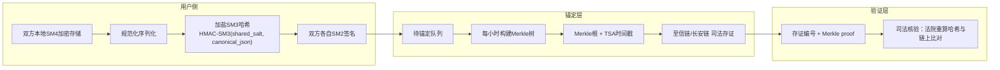
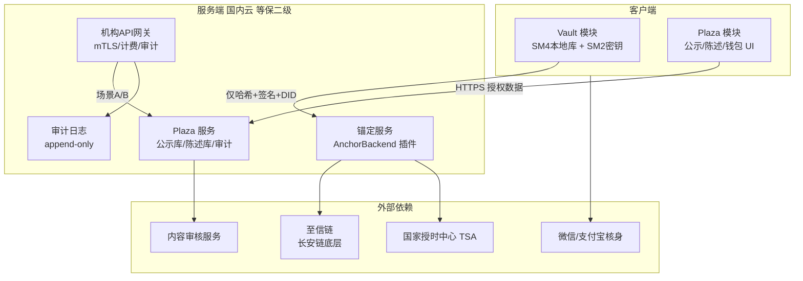

# 《盟书 PactBook》技术白皮书
**版本**：v1.0 | **状态**：发布稿 | **密级**：公开
**开源协议**：客户端与协议层 MIT License
**上游文档**：SRS v1.0（冻结）
---
## 摘要
盟书是一套双边签认、密码学存证的关系信任基础设施。其核心信任主张由四个密码学构件支撑：**端侧国密签名、加盐哈希、Merkle 批量锚定至司法联盟链、可证伪的完整性宣誓**。系统的安全边界由一条架构性事实划定——Vault 区明文永不出用户设备，服务器与任何第三方在任何场景下均不可获取。本文档面向安全研究者、密码学工程师、司法技术评估人员与潜在机构合作方，论述上述构件的设计原理、安全性论证、威胁模型与可审计路径。读者应具备基础密码学知识（哈希函数、数字签名、Merkle 树）。

---
## 1. 设计目标与设计原则
### 1.1 信任主张
系统对用户与司法机构做出四项可验证的技术承诺：
1. **签署不可抵赖**：任何一条关系记录均绑定双方 SM2 签名，签名与身份经实名核身锚定；
2. **内容不可篡改**：记录内容任何一字节的变更将导致哈希失配，链上锚定立即暴露；
3. **时间不可伪造**：锚定时间戳来自国家授时中心 TSA 与区块链分布式共识的双重背书；
4. **删除真实有效**：删除后明文与盐俱灭，链上残留哈希失去计算意义。
### 1.2 设计原则
| 原则 | 含义 | 工程体现 |
|---|---|---|
| **零知识服务器** | 服务器对用户关系内容"零知识"，仅处理加盐哈希 | Vault 区 schema 不含任何明文字段 |
| **可验证性优先** | 任何声称（签名、存证、宣誓）都必须可被第三方独立验证 | Merkle proof、链上浏览器、司法核验 |
| **密码学正确性高于合规标签** | 宁可阻塞功能也不引入实现缺陷（如 ECB 模式、裸哈希） | L2 审核服务不可用时陈述提交暂停 |
| **架构性规避优于权限控制** | 用"数据不在"替代"数据不可见" | Vault 明文仅存设备安全芯片 |
| **开源即审计** | 客户端与协议层 MIT 开源，接受任何人复现构建 | 可复现构建 + SBOM |
---
## 2. 系统架构
### 2.1 架构总图

### 2.2 信任边界
系统划分为四层信任边界，每层的失陷不扩散至下一层：
| 边界 | 失陷后果 | 控制措施 |
|---|---|---|
| 设备层（安全芯片） | Vault 明文暴露 | Secure Enclave/StrongBox 物理防护、密钥不可导出 |
| 服务器层 | 加盐哈希、DID、Plaza 公示数据泄露 | AES-256 加密、HSM 密钥管理、日志脱敏 |
| 锚定层 | 锚定延迟或失败 | 本地重试队列（30 天）、降级为每日批量 |
| 链上层 | 存证不可用 | AnchorBackend 插件化，可切换至天平链或社区节点 |
**关键边界**：服务器失陷不导致 Vault 内容泄露——这是架构性事实，而非配置项。
---
## 3. 密码学设计
### 3.1 国密算法选型依据
| 算法 | 用途 | 安全强度 | 选型理由 |
|---|---|---|---|
| **SM2** | 双签、密钥协商 | 256 位椭圆曲线，等效 RSA-3072 | 司法合规要求 + 短密钥高安全 + 国产自主可控 |
| **SM3** | 哈希（全部 HMAC 加盐） | 256 位输出，对标 SHA-256 | 国内司法链（至信链）原生支持，核验链路无跨算法转换 |
| **SM4** | Vault 本地加密 | 128 位密钥，对标 AES-128 | 国产 CPU（鲲鹏、海光）硬件加速，端侧性能有保障 |
**为何不用 SHA-256/ECDSA/AES**：① 至信链底层采用国密算法作为核心算法，若客户端采用国际算法则核验时需哈希转换，引入不必要的信任节点；② 商用密码合规要求（密评、等保）；③ 国产供应链自主可控。
**实现红线**（吸取"伪国密"教训）：
- SM4 强制 GCM 模式（提供机密性+完整性），禁用 ECB；
- SM2 签名遵循 GM/T 0009 标准编码，禁止自定义曲线参数；
- SM3 全部 HMAC 构造（加盐），禁止裸哈希上链；
- 随机数源强制硬件 TRNG（设备安全芯片），禁止时间戳/序列号伪随机。
### 3.2 哈希加盐：防字典攻击
**问题定义**：关系记录的明文空间极小（时间段、性质枚举、结语模板），若直接上链裸哈希，攻击者可预计算全部可能明文，构建"明文→哈希"查找表，反推出记录内容。
**解决方案**：所有上链哈希一律采用 HMAC-SM3 构造：
```
digest = HMAC-SM3(shared_rel_salt, canonical_json(record))
```
其中 `shared_rel_salt` 为 32 字节随机值，由关系发起方生成，仅经端到端加密通道传递给对方，仅存双方设备，**永不上链、永不出设备**。
**安全性论证**：HMAC 的安全强度取决于底层哈希（SM3 的 256 位）与密钥（256 位盐）。攻击者在不知盐的前提下，需对每条可能的明文执行 2^256 次 HMAC 运算，计算不可行。字典攻击面归零。
**删除后的匿名化**：盐销毁后，链上残留的 `digest` 无法与任何明文关联（盐空间 2^256），依《个人信息保护法》第 4 条"匿名化"定义——"个人信息经技术处理无法识别特定自然人且不能复原"——视为完成删除义务。
### 3.3 双签协议
#### 3.3.1 协议流程
```
发起方 A                        接收方 B
   │                              │
   │── ①邀请码(24h一次性) ──────→│
   │                              │
   │←─ ②接受(经E2E加密通道) ──────│
   │                              │
   │══ ③内容协商(E2E中继,SM4) ══│
   │   服务器只见密文中继          │
   │   中继报文SIGNED后24h删除     │
   │                              │
   │── ④shared_rel_salt ────────→│
   │                              │
   │←─ ⑤B计算digest_B并回传 ──────│
   │   A本地计算digest_A          │
   │   校验 digest_A == digest_B  │
   │   (防内容偷换)                │
   │                              │
   │── ⑥sig_A = SM2Sign(digest) →│
   │←─ ⑦sig_B = SM2Sign(digest) ─│
   │                              │
   │══ ⑧提交锚定服务 ══════════│
   │   {digest, sig_A, sig_B,     │
   │    DID_A, DID_B}             │
```
#### 3.3.2 哈希一致校验（防内容偷换）
E2E 协商通道若被中间人篡改内容，双端将计算出不同 digest。协议在签名前强制校验 `digest_A == digest_B`，不一致则终止——**这是对中间人攻击的结构性防御**，不依赖通道自身的完整性假设。
#### 3.3.3 拒绝无痕
对方拒绝、放弃或超时，邀请方界面恒显示"等待对方响应"，无已读回执、无超时提示。**设计意图**：拒绝本身是敏感信息，系统不留痕。
### 3.4 DID 生成
```
DID = HMAC-SM3(user_salt, 证件号)
```
`user_salt` 为设备安全芯片生成的 32 字节随机值，永不上传。DID 是链上与服务器可见的唯一身份标识——**系统任何组件均无法从 DID 反推证件号**（2^256 盐空间）。
---
## 4. 存证与锚定
### 4.1 Merkle 批量锚定
**问题**：逐条上链成本不可接受（司法链按量计费，单用户单次关系存证若独立上链，成本远超项目承受）。
**方案**：Merkle 树批量锚定——40 年经典密码学构造：
```
每小时锚定周期内：
    leaf_1 = digest_1    leaf_2 = digest_2   ...  leaf_n = digest_n
         \   /                  \   /
        H(l1||l2)             H(l3||l4)
              \                   /
               H(H12||H34)  ...
                     |
                 Merkle Root
                     ↓
         至信链 registerRoot(root)  ← 一笔链上交易
         TSA 时间戳签名
                     ↓
         返回 {tx_id, anchor_ts, merkle_proof_i}
```
**对数验证性质**：含 10 万叶子的树，证明单条记录在树内仅需 log₂(100000) ≈ 17 个兄弟哈希。**验证成本与集合规模无关**——这是批量锚定可行的数学基础。
#### 4.1.1 Merkle 证明示例
假设树含 8 条记录，用户要证明 `digest_3` 在树内：
```
Level 3:                             root
Level 2:              H(H01||H23)        H(H45||H67)
Level 1:      H(01)      H(23)      H(45)      H(67)
Level 0:  d0  d1  d2  d3  d4  d5  d6  d7
                   ↑
                digest_3
证明路径（3 个兄弟哈希）：
  { H23,          ← Level 1 兄弟
    H45,          ← Level 2 左侧
    H(H01||H23)   ← Level 2 兄弟（即左子树根） }
验证计算：
  v1 = SM3(d3 || ?)  → 与 H23 组合 → H23'
  v2 = SM3(H23' || H45)
  v3 = SM3(H(H01||H23) || v2)
  校验 v3 == 链上 root  ✓
```
用户本地留存此证明（约 17×32 字节），配合链上 `tx_id` 与 `anchor_ts`，任何人可独立验证。
### 4.2 锚定链选择：至信链
**选择依据**：
| 维度 | 至信链 |
|---|---|
| 底层技术 | 长安链（国产自主可控开源区块链） |
| 公信节点 | 工信部一所、互联网法院、公证处等十余家公信力机构 |
| 司法采信 | 全国多地法院当庭采信（广州互联网法院著作权首案、鄂尔多斯跨省核验首案等） |
| 密码支撑 | 国密算法为底层算法，接入国家密码管理局鉴定的时间戳服务商 |
| 日均规模 | 35 万条/日 |
**AnchorBackend 插件化**：锚定服务定义为开源接口：
```rust
trait AnchorBackend {
    fn anchor(&self, digests: &[Digest]) -> Result<AnchorResult, AnchorError>;
}
struct AnchorResult {
    merkle_root: [u8; 32],
    tx_id: String,
    anchor_ts: u64,
    proofs: Vec<MerkleProof>,
}
```
社区可自建实现（天平链直连、公有链 OP_RETURN、社区联盟节点），切换后端不需客户端发版。
### 4.3 TSA 时间戳
每笔锚定附带国家授时中心 TSA 签名的时间戳。时间可信来源有三重保障：TSA 中心化背书 + 区块链分布式时间戳 + 法院核验时的系统时钟交叉校验。**单点时间伪造不可行**。
### 4.4 锚定降级策略
| 条件 | 动作 | 用户感知 |
|---|---|---|
| 捐赠余额充足 | 每小时批量锚定 | 产品内显示"当前锚定周期：1 小时" |
| 余额低于阈值 | 降级为每日一次 | 产品内如实展示"当前锚定周期：24 小时" |
| 锚定服务故障 | 本地重试队列，最长 30 天 | "待锚定"状态，不影响本地功能 |
**设计意图**：降级是产品透明事件而非静默劣化——锚定周期本身就是捐赠透明度的组成部分。
---
## 5. 完整性宣誓机制
### 5.1 设计原理
**问题**：系统无法强制用户录入全部关系（无爬虫、无外部数据源、无强制），用户可选择性录入"体面"的关系、隐藏"不光彩"的关系。系统如何证明"你看到的就是全部"？
**方案**：完整性宣誓——用户对 `{档案计数, 区间摘要, 宣誓日, "完整无遗漏"承诺}` 进行 SM2 签名并锚定。
```
宣誓内容示例：
{
  "total_relationships": 5,
  "closure_distribution": {"peaceful": 3, "unilateral": 1, "ongoing": 1},
  "attestation_date": "2026-10-21",
  "statement": "本人声明本档案即全部关系记录，无遗漏"
}
sig_attest = SM2Sign(HMAC-SM3(user_salt, canonical_json(above)))
```
### 5.2 可证伪性论证
宣誓的威慑力来自其**可证伪性**：
| 场景 | 后果 |
|---|---|
| 用户宣誓后新增关系 | 新关系锚定时，链上可见宣誓日之后的 `anchor_ts`，与"完整无遗漏"矛盾 |
| 用户宣誓前删除旧关系 | 墓碑交易 `anchor_ts` 早于宣誓日，链上可见 |
| 前任出示存证编号 | 编号可在链上核验，若早于宣誓日且用户未录入，宣誓被证伪 |
**证伪后果**：宣誓状态强制变更为"⚠️ 曾有虚假宣誓记录"，**公开且不可关闭**——这是全产品唯一的强制公开变更。变更须双人复核 + 证据链入审计日志。
**本质**：宣誓是"技术无法验证的内容"与"技术可验证的签名"之间的桥梁。系统不能证明你说了实话，但可以证明你签了字——**签字的后果由法律与声誉体系接管**。
---
## 6. 数据治理
### 6.1 分类分级
| 级别 | 数据 | 位置 | 保留期 |
|---|---|---|---|
| **L4** | Vault 明文、SM2 私钥、所有盐 | 仅设备（安全芯片/SM4 加密库） | 用户主控 |
| **L3** | certify_id / person_token | 服务器（加密） | 账号存续期 |
| **L2** | Plaza 公示字段、陈述、答辩 | Plaza 库（AES-256） | 撤下后 ≤ 30 天 |
| **L1** | 哈希、签名、Merkle proof 索引、审计日志 | 服务器 / 链上 | ≥ 3 年 |
### 6.2 删除：墓碑机制
```mermaid
flowchart LR
    A[用户发起删除] --> B[本地SM4密钥销毁]
    B --> C[所有盐销毁<br/>user_salt + shared_rel_salt]
    C --> D[明文物理不可恢复]
    D --> E[墓碑交易上链<br/>{digest, deleted_at}]
    E --> F[链上残留哈希<br/>失去字典攻击面]
    F --> G[依PIPL第4条<br/>视为完成删除义务]
    H[Plaza数据] --> I[公示撤下]
    I --> J[服务器保留30天]
    J --> K[物理删除]
```
**匿名化论证**：删除后链上残留 `digest = HMAC-SM3(salt, content)`，其中 `salt` 已销毁。攻击者要从此哈希反推明文，需穷举 2^256 盐空间 × 明文空间，计算不可行。哈希值**不再指向任何特定自然人**——满足 PIPL 第 4 条匿名化定义。
### 6.3 生命周期矩阵
| 数据 | 产生 | 修改 | 删除 |
|---|---|---|---|
| Vault 记录 | 双签时 | 关闭协议时 | 用户主控（墓碑） |
| 公示配置 | opt-in 时 | 每日 1 次 | 一键撤下 |
| 陈述 | 关闭后提交 | 7 天内锁定 | 撤下 30 天后物理删除 |
| 授权记录 | 场景 B 每次授权 | 不可改 | 随账号删除 |
| 链上哈希 | 锚定时 | **不可改**（设计如此） | 墓碑声明（匿名化） |
---
## 7. 接口设计
### 7.1 场景 A：批量查询公示信息
```
POST /v1/public/query
认证：mTLS（机构客户端证书）+ IP 白名单 + API Key + 请求体签名
请求体：
{
  "subject_public_id": "pb_xxxxxxxx",
  "fields": ["relationship_band", "attestation_status", "statements"]
}
响应（200）：
{
  "granted_fields": {
    "relationship_band": "3-5",
    "attestation_status": "verified",
    "statements": [...]
  },
  "attestation_hash": "0x...",
  "verify_url": "https://mengshu.love/...",
  "valid_until": "2026-10-21T10:35:00Z"   ← 有效期戳 ≤ 5min
}
```
**有效期戳设计**：每个响应携带 `valid_until = now + 5min`，合同强制机构在 `valid_until` 后不得继续使用该数据。**撤回传播由 TTL 天然兜底**——即使机构缓存失效机制故障，数据也在 5 分钟后失去使用合法性。
### 7.2 场景 B：本人现场授权
```
① POST /v1/consent/init       → 返回授权页 URL（10min 内有效）
② 用户在授权页逐项勾选字段（全屏独立界面，六要素告知）
③ GET  /v1/consent/callback   → 授权码 code（5min，单次）
④ POST /v1/consent/exchange   → code 换 access_token（10min，单次拉取）
⑤ POST /v1/consent/data       → 凭令牌拉取授权字段（摘要级）
⑥ 传输凭证写入用户授权台账
```
**可授权字段集边界**：Plaza 公示字段 + 存证核验 URL。**Vault 明细不在此集合中——本人现场授权也不可突破。**
### 7.3 审计日志
全部授权、查询、公示变更、审核操作写入 append-only 审计日志，保留 ≥ 3 年：
```
audit_log(event_id, event_type, actor, subject, detail_hash, ts)
```
用户可在隐私中心导出全部授权记录（带平台 SM2 签名的 CSV/PDF）。
---
## 8. 威胁模型
采用 STRIDE 框架分析：
| 威胁类别 | 攻击场景 | 对策 | 残余风险 |
|---|---|---|---|
| **S** 伪装 | 伪造 SM2 签名冒充他人 | 私钥不可导出（安全芯片）+ 实名核身绑定 | 极低（需物理接触设备+绕过芯片防护） |
| **T** 篡改 | 双签后修改本地记录 | 重算哈希与链上锚定失配，篡改立即暴露 | 极低（哈希碰撞计算不可行） |
| **T** 篡改 | 中间人篡改 E2E 协商内容 | 签名前 digest_A == digest_B 校验 | 极低 |
| **R** 抵赖 | "不是我签的" | SM2 签名 + 实名核身 + 链上存证，司法采信 | 极低 |
| **I** 信息泄露 | 服务器被攻破，拖库 | Vault 零存储（架构性）；Plaza AES-256；日志脱敏 | Plaza 公示数据本身已公开，泄露无增量损失 |
| **I** 信息泄露 | 链上哈希被字典攻击 | HMAC 加盐，盐永不上链 | 无（盐空间 2^256） |
| **D** 拒绝服务 | 锚定服务 DDoS | 本地重试队列 30 天 + AnchorBackend 切换 | 锚定延迟，不丢失 |
| **D** 拒绝服务 | 机构 API DDoS | QPS ≤ 1 令牌桶 + mTLS + IP 白名单 | 低 |
| **E** 特权提升 | 平台内部人员越权 | Vault 数据服务器不存在（无权可越）；审计双人复核 | 无（数据不在） |
| **E** 特权提升 | 机构超范围使用数据 | 合同违约金 + 审计权 + API 吊销 + TTL 失效 | 合同执行依赖法律体系 |
**关键安全边界**：Vault 数据的"不存在性"是所有威胁的终极防线——**无法泄露不存在的东西**。
---
## 9. 可审计性
### 9.1 开源审计
| 组件 | 开源状态 | 审计内容 |
|---|---|---|
| 客户端 | MIT | Vault 加密实现、SM2/SM3/SM4 调用正确性、协议流程 |
| 协议层 | MIT | 双签协议、Merkle 构造、墓碑机制 |
| AnchorBackend 接口 | MIT | 锚定插件规范 |
| Plaza 服务端 | 建议同开源 | 公示白名单、审计日志不可篡改性、schema 无 PII 字段 |
| 构建系统 | 可复现构建 + SBOM | 供应链可信：任何人可从源码复现发布包 |
**schema 级自证**：开源后任何人可核验——服务端无任何姓名/手机号/身份证/人脸字段（详见 SRS §6.2）。
### 9.2 外部审计清单
| 审计项 | 频率 | 标准 | 结果公开 |
|---|---|---|---|
| 渗透测试 | 年检 + 重大版本前 | OWASP + 自定义 Vault 隔离性用例 | 报告摘要公开 |
| 密评 | 年检 | GM/T 0054 商用密码应用安全性评估 | 报告摘要公开 |
| 等保测评 | 年检 | 等保二级（起步） | 备案证明公开 |
| 代码审计 | 持续 | 社区审计 + 第三方抽审 | GitHub Security 栏 |
### 9.3 出证报告
用户可生成带平台 SM2 签名的 PDF 出证报告，内含：
```
{
  存证编号,
  关系哈希 digest,
  双方签名 sig_A, sig_B,
  Merkle proof,
  链上 tx_id,
  TSA 时间戳 anchor_ts,
  核验 URL  ← 任何人可访问，输入哈希即验证
}
```
**验证独立性**：报告的验证不依赖平台存活——核验 URL 可指向任何镜像或用户本地运行的开源验证工具。
---
## 10. 性能与容量
### 10.1 延迟预算
| 操作 | 预算 | 实测目标 |
|---|---|---|
| 本地 SM2 签名（中端机） | < 100ms | < 80ms |
| Merkle 树构建（10 万叶子） | < 60s | 后台异步，不阻塞用户 |
| 公开主页加载（P95） | < 500ms | < 400ms |
| 授权弹窗端到端 | < 200ms | < 150ms |
| 撤回传播（公开页） | ≤ 1min | — |
| 撤回传播（API） | ≤ 5min | TTL 兜底 |
### 10.2 容量估算
**假设**：首年 10 万注册用户，月互证 5000 次，公示率 15%。
| 项 | 估算 |
|---|---|
| 月锚定记录数 | 5000 互证 + 2000 关闭 + 500 宣誓 + 300 墓碑 ≈ 7800 条 |
| 单 Merkle 树容量 | 10 万叶子 → 每树可承载 ~12.8 个月的锚定量 |
| 实际锚定频率 | 每小时批量，单树平均 < 11 条叶子 |
| 单条锚定成本 | 至信链按量计费 ÷ Merkle 批量摊薄 → 厘级/条 |
| 月锚定成本 | 7800 × 厘级 ≈ 百元级 |
| Plaza 存储 | 公示用户 1.5 万 × 平均 2KB ≈ 30MB |
| 审计日志 | 全事件 ~50 万条/月 × 200B ≈ 100MB/月 |
**结论**：捐赠收入完全可覆盖锚定成本——这是"开源 + 捐赠"模式可行的数学基础。
---
## 11. 与其他方案的对比
| 维度 | 盟书 PactBook | 腾讯电子签 | 纯链上方案 | 纯本地方案 |
|---|---|---|---|---|
| 数据主权 | 用户（零服务器存储） | 平台（服务器全存） | 用户（但内容上链=永久公开） | 用户（但无第三方验证） |
| 内容隐私 | 强（HMAC 加盐） | 中（服务器可见明文） | **弱（内容哈希裸上链，字典攻击风险）** | 强（但无锚定） |
| 司法效力 | 至信链 + 双签 + TSA | 至信链 + 单签 | 取决于链的司法认可 | 无 |
| 防篡改 | 链上锚定 | 链上锚定 | 链上原生 | 弱（依赖本地备份） |
| 匿名性 | DID（HMAC 加盐证件号） | 实名（服务器明文） | 取决于实现 | 本地匿名 |
| 可删除性 | 墓碑机制（匿名化路径） | 平台删除 | **不可删除（链上永久）** | 直接删除 |
| 单条成本 | 厘级（Merkle 批量） | 商业定价 | Gas 费（波动大） | 零 |
| 开源审计 | MIT 全开源 | 闭源 | 视项目而定 | 视项目而定 |
| 定位 | 专用关系信任工具 | 通用合同工具 | 通用存证 | 通用笔记 |
**关键差异**：盟书不是"用通用工具做感情的事"，而是为关系场景专门设计的信任原语——HMAC 加盐针对关系明文空间小的问题，完整性宣誓针对"选择性录入"的问题，墓碑机制针对"被遗忘权"的问题。
---
## 12. 已知限制
诚实披露，接受社区监督：
1. **依赖核身服务商的 person_token 唯一性**（假设 A-1）：若微信/支付宝不提供恒定唯一标识，防一人多号依赖 certify_id 去重 + 合同约束 + 定期审计，存在残余风险；
2. **SM4 安全强度等效 AES-128，非 AES-256**：Vault 本地加密选择 SM4 是合规与性能的折衷。若未来国密推出 256 位对称算法，将升级（AnchorBackend 式插件化预留）；
3. **链上锚定的不可撤销性**：墓碑机制是"匿名化"路径，非"物理删除"——链上哈希永久存在，只是失去计算意义。这是所有区块链存证系统的共同局限；
4. **设备丢失 = Vault 数据丢失**：无服务器备份（设计如此）。助记词备份是唯一恢复路径，丢失助记词且丢失设备 = 数据永久丢失；
5. **至信链单点依赖**：当前官方锚定后端为至信链。若其服务终止或政策变化，切换需重新走 AnchorBackend 插件的接入流程（技术可行，但有时间成本）；
6. **小程序轻版不支持 Vault 双签**：因微信小程序环境无法保证密钥安全（无安全芯片 API 访问），仅提供公开页查看与授权码验证。
---
## 13. 结语
盟书的技术哲学可以用一句话概括：
> **我们不为用户的诚实提供担保，我们为用户的谎言设置成本。**
签名、哈希、锚定、宣誓——每一个构件都不是在验证内容真伪（那是法律与社会的职责），而是在**固化声明行为本身**，使得日后的任何抵赖、篡改、选择性遗忘都在密码学层面留下不可磨灭的痕迹。
用户可以不签、可以拒签、可以签了再删（付出墓碑成本）——**选择权永远在用户手中**。但一旦签了，事实就被钉在链上。
这就是"可信"的全部技术含义。
---
**文档结束**
**技术问题反馈**：GitHub Issues 标签 `tech-whitepaper`
**安全漏洞披露**：`mengshulove@126.com（PGP 公钥见仓库 `docs/法律/安全.md`）
**密码学审校意见**：尤其欢迎对 SM2/SM3/SM4 实现规范性与 Merkle 构造正确性的独立审计
